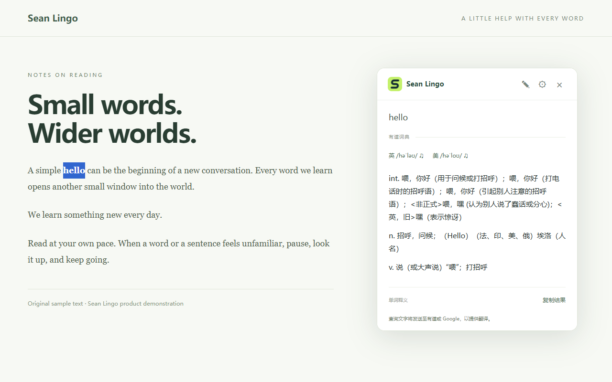

# Sean Lingo 1.0.0


让阅读，简单一点。免费、无需注册的 Chrome / Edge 单词查询与句子翻译扩展。

源码仓库：[Sean1shao/sean-lingo](https://github.com/Sean1shao/sean-lingo)。许可证：GPL-3.0。

支持邮箱：759112444@qq.com。所有当前功能免费使用，自愿赞助不解锁功能。尚未配置赞助平台链接，因此界面不显示赞助按钮。

## 功能

- 网页划词按钮、右键翻译、Alt + L、工具栏手动输入。
- 英汉/汉英单词释义、英文音标及英美在线发音。
- Google / 有道句子翻译，自动失败回退，最多 3000 字符。
- 可拖动浮窗、编辑原文、复制结果、错误提示和重试。
- 源语言、目标语言、翻译服务及划词开关设置。
- 内置联系开发者、隐私政策及开源声明。

不包含 AI、账号、生词本、收藏、网页生词高亮或云同步。



## 安装与发布材料

先按下方步骤构建，再打开 `chrome://extensions` 或 `edge://extensions`，开启开发者模式，选择“加载已解压的扩展程序”，加载 `dist/chrome` 或 `dist/edge`。安装后刷新已打开的普通网页。

在 Windows PowerShell 中运行 `./scripts/package.ps1` 可在本地 `release/` 生成 Chrome、Edge 和对应源码 ZIP。打包脚本排除 `.vite` 构建元数据，并验证安装包只有一个根目录 `manifest.json`。

发布文案、权限说明及上架资料见 [publishing/](publishing/)。[public/legal/privacy.html](public/legal/privacy.html) 是可直接托管的中英文隐私政策；商店需要单独填写公开 HTTPS 地址。商店状态及安装链接以正式商店页面为准。

## 开发

```sh
git clone https://github.com/Sean1shao/sean-lingo.git
cd sean-lingo
npm ci
npm run dev:chrome
npm run build:chrome
npm run build:edge
npm run lint
npm test
```

建议使用 Node.js 24。`npm test` 只运行本地解析测试，不访问在线翻译服务。

可选端到端验证：安装 Playwright（例如 `npm install --no-save --package-lock=false playwright`），运行 `npx playwright install chromium`，构建 Chrome 版本后执行 `node scripts/verify.mjs`。它会检查真实在线服务、品牌、隐私页面及划词交互；公共接口不可用或被限流时可能失败。可用 `CHROMIUM_PATH` 指定支持加载未打包扩展的浏览器，或用 `CODEX_NODE_MODULES` 指定已安装依赖的绝对目录。测试浏览器沿用 `HTTPS_PROXY`，扩展本身不内置代理。

`branding/` 保存可编辑 SVG，PNG 已包含在源码中，正常构建无需图像工具。需要重新导出图标时，安装 sharp（例如 `npm install --no-save --package-lock=false sharp`），运行 `node scripts/brand-assets.mjs`。`node scripts/legal-pages.mjs` 重新生成隐私与许可页面。更换服务或数据处理方式时，须同步更新隐私说明。

## 服务与数据

这些是在线词典/翻译服务，无需下载本地模型。Google 依赖可访问其服务的网络；有道支持中英、中日、中韩、中法互译，日/韩/法语需明确选择源语言。词典释义限英译简体中文和中译英语；其他目标语言使用句子翻译。公共接口可用性可能变化。

只在用户主动查询时发送查询文本到所用服务，不持久保存查询历史。偏好存储在浏览器本地；词典响应短暂缓存在后台内存。详见 public/legal/privacy.html。

## 许可与来源

基于 chengfengfengwang/lingo-link 修改，继续按 GNU GPL version 3 分发，保留原代码的版权和许可通知。上游：https://github.com/chengfengfengwang/lingo-link。

详见 [LICENSE](LICENSE)、[NOTICE.md](NOTICE.md) 和 [THIRD_PARTY_NOTICES.txt](THIRD_PARTY_NOTICES.txt)。运行时界面使用 Sean Lingo 产品名称，以及产品所有者提供的 Seanivo 个人品牌 S 图标（来源见 [branding/SOURCE.md](branding/SOURCE.md)）。Git 历史保留上游来源；本地 `reference/` 备份不纳入此仓库。

本仓库包含本版完整构建源码。对外分发安装包时，应按 GPL-3.0 提供匹配版本的源码或源码下载地址；仅链接未修改的上游仓库不能替代本版源码。

## 反馈与贡献

欢迎提交 Issue 或 Pull Request。请说明浏览器版本、操作步骤及错误提示；不要提交访问令牌、API Key 或不希望公开的查询内容。
